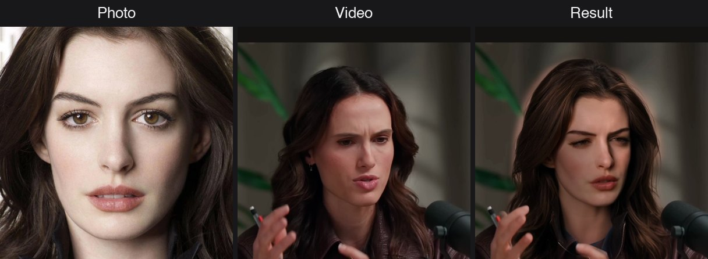
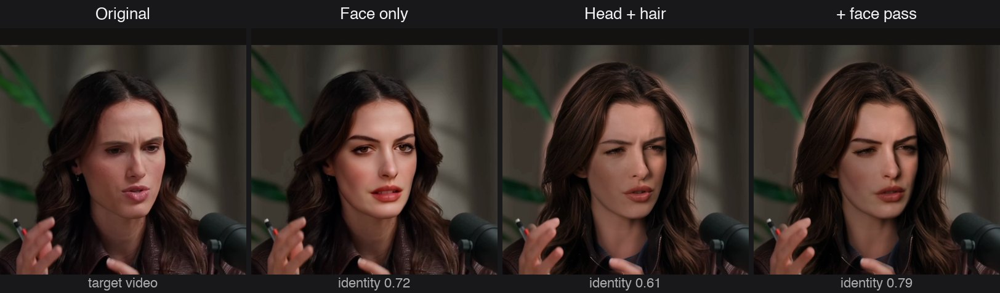
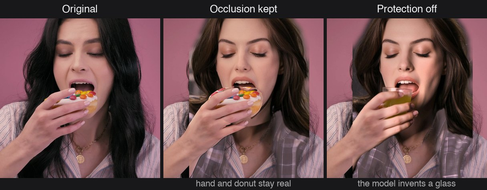
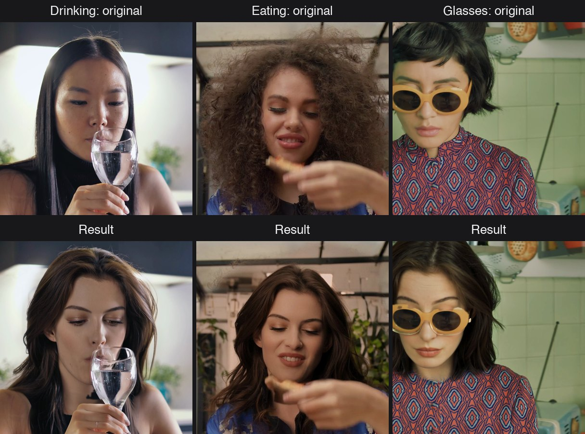
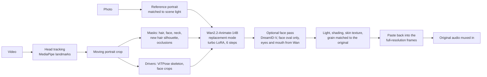

# Local FaceSwap macOS

**Swap a whole head (face and hair) or just the face in a video, using one photo, fully local on an Apple Silicon Mac.**
No cloud, no upload, no NVIDIA GPU. Body, clothes, background, camera motion and the original audio stay untouched.



Most high-quality face-swap tools assume a CUDA GPU or a web service. Local FaceSwap macOS runs current video diffusion models natively on the Mac's GPU (Metal / MPS) and wraps them in a terminal app that checks your inputs, estimates the run time, shows live progress and keeps a history of every result.

## Features

- **Head + hair swap** with Wan2.2-Animate-14B: the new person's hairstyle and head shape, driven by the expressions and head motion of the video.
- **Face-only swap** with DreamID-V when hair and head shape should stay.
- **Face pass**: a second DreamID-V pass on the generated head that raises the likeness to the photo from 0.61 to 0.79 (AuraFace, see below).
- **No "AI look"**: the new head takes the scene's exposure, white balance, shading, skin texture and film grain.
- **Occlusions stay real**: hands, food, cups and microphones in front of the face are kept from the original, and the face is rebuilt behind them.
- **Measurable results**: every run reports how similar the result is to the photo and writes a `.json` with all settings next to the video.
- **Comfortable app**: guided menus, input checks, time estimates, a live progress panel, side-by-side comparison videos, a history, and fine-tuning of light and mouth without regenerating.

## Examples

**Face only vs. head + hair.** Face only keeps the original hair. Head + hair also brings the new hairstyle, and the face pass makes the face itself closer to the photo.



**Occlusions.** With protection on, the hand and the donut stay real. Without it, the model invents its own object.



**Everyday footage.** Drinking, eating and worn sunglasses. Sunglasses are swapped together with the head.



## How it works



1. **Tracking.** MediaPipe finds 478 face landmarks in every frame. A smoothed portrait crop follows the head, so the model always sees it large and centred, whatever the video resolution.
2. **Masks.** Hair, face and neck of the old head are segmented. The silhouette of the new hair is projected onto every frame, so longer hair has room to appear. Hands and objects in front of the face are cut out of the mask: the model treats them as fixed picture content and builds the face behind them.
3. **Generation.** Wan2.2-Animate-14B regenerates only the masked region. A ViTPose skeleton and face crops of the video drive head pose and expressions. The relighting LoRA lets the new head take the scene's light, and the lightx2v distillation LoRA cuts sampling to 6 steps. Long clips run in 77-frame windows that continue from the previous window.
4. **Face pass (optional).** Wan-Animate gets hair, head shape and motion right but loses likeness when the face is large. DreamID-V swaps just the face on top of the generated head. It is applied inside the face oval only, and eyes and mouth can come from Wan, so gaze, blinks and mouth opening still follow the original.
5. **Blending.** The new head gets the original face's exposure, white balance and light direction (measured on skin only), the skin texture of the footage and matching film grain. It is then pasted into the untouched full-resolution frames with a feathered mask. Original occlusions are laid back on top.
6. **Output.** Frame rate and audio are kept. AuraFace (an ArcFace-type recognition model) measures how similar the result is to the photo.

**Face-only mode** cuts a square crop around the face, swaps it with DreamID-V at (or above) the face's native resolution and blends it back into the full-resolution frames. Running the model on the whole frame instead would shrink a 1080×1920 video to 464×832 and re-render everything soft.

The models were made for CUDA. This project runs them on MPS:
- SDPA instead of flash-attention, real-valued RoPE, and fp32 islands instead of CUDA autocast.
- The DiT runs in bf16 and the VAE on the GPU; T5 prompt embeddings are cached on disk.
- LoRAs are merged into the base weights, and the 14B DiT is loaded through RAM (Metal stalls on mmap-backed copies).

## Requirements

| | |
|---|---|
| Mac | Apple Silicon (M1 or later). Developed and measured on an M5 Max with 128 GB. |
| Memory | Head swap: about 45 GB of unified memory while running, so 64 GB is the minimum and 96 GB or more is comfortable. Face only uses a 1.3B model and needs less. |
| Disk | About 75 GB for the models, plus space for results. |
| Software | macOS, Python 3.11, [Homebrew](https://brew.sh) with `ffmpeg`. |

Run times for a 3.2 s clip (77 frames at 24 fps) on an M5 Max. The first start takes a little longer while the models load.

| Head + hair profile | Settings | Time | Likeness to photo |
|---|---|---|---|
| Fast | `--preset fast --turbo` | ~6 min | for testing |
| Standard | `--preset best --turbo` | ~11 min | 0.61 |
| **Maximum likeness** (default) | `--preset best --turbo --face_pass balanced` | ~19 min | 0.79 |
| Best of 3 variants | … `--candidates 3` | ~38 min | best seed of 3 |
| Classic without turbo | `--preset best` (25 steps) | ~37 min | 0.53 |

| Face-only profile | Crop | Time per 3.2 s |
|---|---|---|
| Fast | 448 px, 20 steps | ~5 min |
| Balanced (default) | 512 px, 25 steps | ~9 min |
| Best | 640 px, 30 steps | ~16 min |

The likeness score is the AuraFace cosine similarity between the result and the photo. A different person scores about 0.0–0.2, the same person about 0.9.

## Installation

```sh
# 1. Tools
brew install python@3.11 ffmpeg

# 2. Code and Python environment
git clone https://github.com/<your-account>/local-faceswap-macos.git
cd local-faceswap-macos
python3.11 -m venv .venv
source .venv/bin/activate
pip install -r requirements.txt

# 3. Models (about 75 GB)
#    Wan2.2-Animate-14B: head + hair (the SAM2 checkpoints are not needed)
hf download Wan-AI/Wan2.2-Animate-14B --local-dir models/wan2.2-animate-14B --exclude "process_checkpoint/sam2/*"
#    DreamID-V: face pass and face-only mode
hf download XuGuo699/DreamID-V dreamidv.pth --local-dir models
#    Wan2.1 VAE for DreamID-V; text encoder and tokenizer are shared with Wan2.2
hf download Wan-AI/Wan2.1-T2V-1.3B Wan2.1_VAE.pth --local-dir models/wan2.1-1.3B
ln -s ../wan2.2-animate-14B/models_t5_umt5-xxl-enc-bf16.pth models/wan2.1-1.3B/
cp -R models/wan2.2-animate-14B/google models/wan2.1-1.3B/
```

The turbo LoRA (0.7 GB), the AuraFace identity model and the MediaPipe segmentation and hand models download themselves on first use.

```text
models/
├── wan2.2-animate-14B/      Wan2.2-Animate-14B (DiT, VAE, T5, CLIP, relighting LoRA, process_checkpoint/)
├── wan2.1-1.3B/             Wan2.1_VAE.pth, models_t5_umt5-xxl-enc-bf16.pth (link), google/umt5-xxl/
├── dreamidv.pth             DreamID-V weights
└── loras/                   turbo LoRA (automatic) and optional extra LoRAs
```

The app's **Models and system** screen shows whether everything is in place.

## Usage

### The app

Double-click **`Local FaceSwap.command`** in Finder, or run:

```sh
source .venv/bin/activate
python app.py
```

Everything works with the arrow keys and Enter:

1. **Photo and video.** Type a path (Tab completes) or drag the file into the terminal. The app checks both right away: is there a face, how large is it, is there room above the head for the hair, is the head turned, and is the face visible throughout the video.
2. **Mode.** Head + hair, or face only.
3. **Range.** The whole video, a 3.2 s quick test, or any start and length.
4. **Quality profile.** Each profile shows its estimated run time for the chosen range.
5. **Extras.**
   - Keep occlusions original (on by default).
   - Eyes and mouth follow the original (on by default with the face pass).
   - Mouth interior from the original.
   - Comparison video.
   - Keep intermediate results.
   - Extra LoRA.
6. **Run.** A live panel shows the stage, window and step, the elapsed and remaining time, and the latest log lines. `Ctrl+C` asks before it stops anything.
7. **Result.**
   - The likeness score with a rating.
   - Play the result or the side-by-side comparison, or show it in Finder.
   - With kept intermediates, change light and mouth in about a minute without regenerating.

**History** lists every run in `output/` with date, range, settings, score and duration.

### Command line

```sh
# Head + hair, recommended settings
python headswap.py --ref_image photo.jpg --video clip.mp4 --preset best --turbo \
    --face_pass balanced --wan_mouth 0.6 --wan_eyes 1 --start 2 --seconds 6

# Face only
python faceswap.py --ref_image photo.jpg --video clip.mp4 --preset balanced --seconds 6

# Side-by-side video (original | result, head crop, with audio)
python compare.py --original clip.mp4 --result output/head_clip_....mp4 --start 2
```

Without `--out`, the file name contains the settings, for example `output/head_clip_best_turbo_facepass-balanced-wanmouth0.6-waneyes1_<time>.mp4`. Every result gets a `.json` with all settings, the time range, the score and the run time. `--help` lists every option.

**Options that measurably help.** All values are from 3.2 s test clips:

| Option | Effect | Cost |
|---|---|---|
| `--turbo` | lightx2v step-distillation LoRA: 6 instead of 25 steps. Likeness 0.53 → 0.61, same expressions. | 4× faster |
| `--face_pass balanced` | DreamID-V pass on the generated head, inside the face oval. Likeness 0.61 → 0.81. | +8 min per 3.2 s |
| `--wan_mouth 0.6 --wan_eyes 1` | With the face pass: gaze, blinks and mouth opening follow the original. Mouth opening 0.86 → 0.94 of the original, no more mismatched eyes. Likeness 0.81 → 0.79. | – |
| occlusion handling (default on) | Hands, food and cups stay real. On a real eating clip the hand and donut differ from the original by 2.1 grey levels with protection and 58.8 without. | – |
| `--candidates N` | Generates N seeds and keeps the one closest to the photo. The seed alone moved likeness between 0.60 and 0.68. | N× generation |
| `--keep_mouth` | Teeth, tongue and food in the mouth come from the original video, fitted into the new lips. | – |
| `--keep_temp`, then `--from_work <folder>` | Keeps the generation, so light (`--light`, `--shade`), mouth and eye options can be changed in about a minute. | disk space |
| `--lora PATH[:STRENGTH]` | Merges any extra Wan 14B LoRA. | – |

Tested and not worth it: 8 instead of 6 turbo steps (likeness 0.59 vs. 0.61, +5 min) and a skin-detail LoRA (no difference).

## Tips for good results

- **Photo.**
  - Sharp, natural (not retouched) and frontal.
  - The face is at least ~300 px tall.
  - The hair is fully visible.
- **Video.** The face is visible most of the time. The larger it is in the frame, the more the face pass helps.
- **Before a long clip,** check photo and settings with the 3.2 s quick test.

## Known limits

- It is not real time: a 3.2 s clip takes 6–19 minutes, depending on the profile.
- When food is held at the mouth, the model sometimes invents food remains on the chin below the hand.
- When the chin is heavily covered, the face pass can leave a faint grey shadow there.
- Sunglasses hide the eyes, so the likeness score drops to about 0.3 even when the swap itself works.
- Developed and measured on one machine (M5 Max, 128 GB). Smaller Macs need more time, and below 64 GB the head swap does not fit.

## Responsible use

Only use photos and videos of people who have agreed to it. Mark swapped videos as synthetic when you share them, and follow the law where you live; in many countries, publishing someone's likeness without consent is illegal. Do not use this tool to deceive, harass or impersonate anyone.

## Project layout

```text
app.py                    terminal app
headswap.py               head + hair pipeline (Wan2.2-Animate-14B, face pass, blending)
faceswap.py               face-only pipeline (DreamID-V)
compare.py                side-by-side comparison videos
Local FaceSwap.command    double-click launcher
engines/                  bundled model code (see engines/README.md)
models/                   model weights (not in git)
output/                   results, logs and kept work folders (not in git)
```

## Credits and license

Local FaceSwap macOS is released under the [Apache License 2.0](LICENSE). It builds on these open models and projects, all Apache-2.0:

- [Wan2.2-Animate-14B](https://github.com/Wan-Video/Wan2.2) by the Alibaba Wan team: head + hair generation.
- [DreamID-V](https://github.com/bytedance/DreamID-V) by ByteDance and Tsinghua University: face pass and face-only mode.
- [MediaPipe](https://github.com/google-ai-edge/mediapipe) by Google: landmarks, segmentation, hands.
- [AuraFace](https://huggingface.co/fal/AuraFace-v1) by fal: identity score.
- [lightx2v](https://huggingface.co/lightx2v) step-distillation LoRA, as packaged by [Kijai](https://huggingface.co/Kijai/WanVideo_comfy): turbo mode.

Bundled model code keeps its original copyright headers, and modified files are marked (see [engines/README.md](engines/README.md)). Example images: the photo and the talking-head clip come from the DreamID-V test set, the eating, drinking and sunglasses clips from [Mixkit](https://mixkit.co) (free license).
